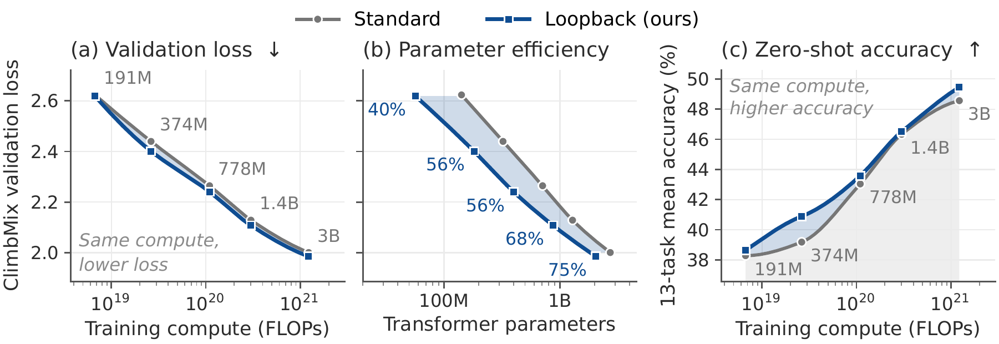
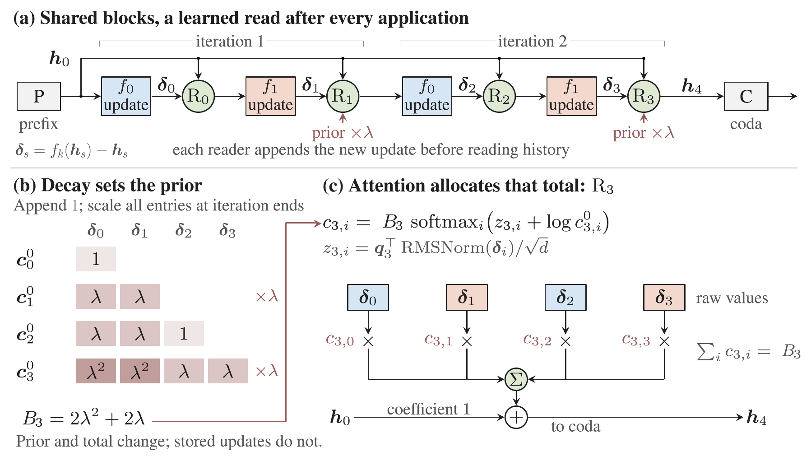
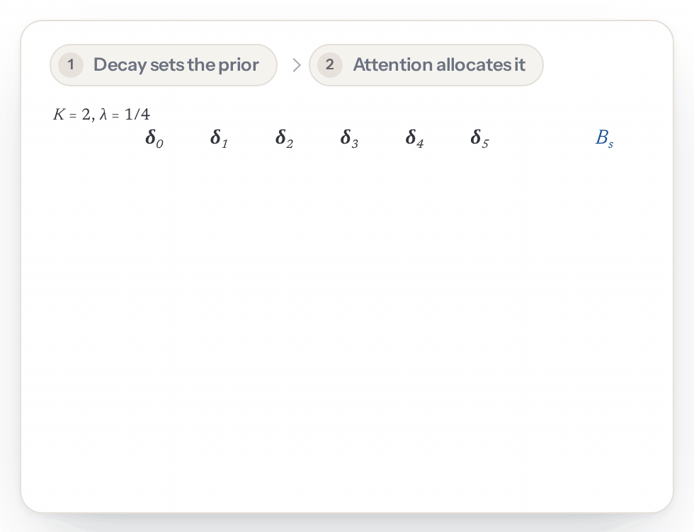
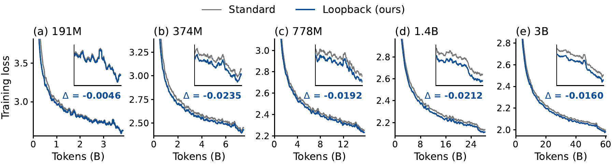
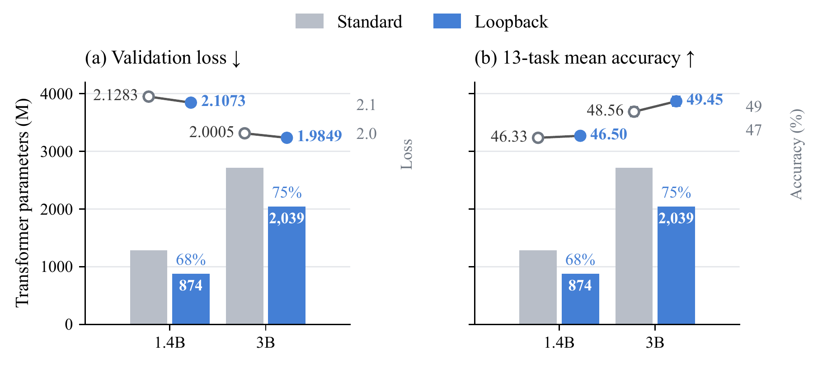
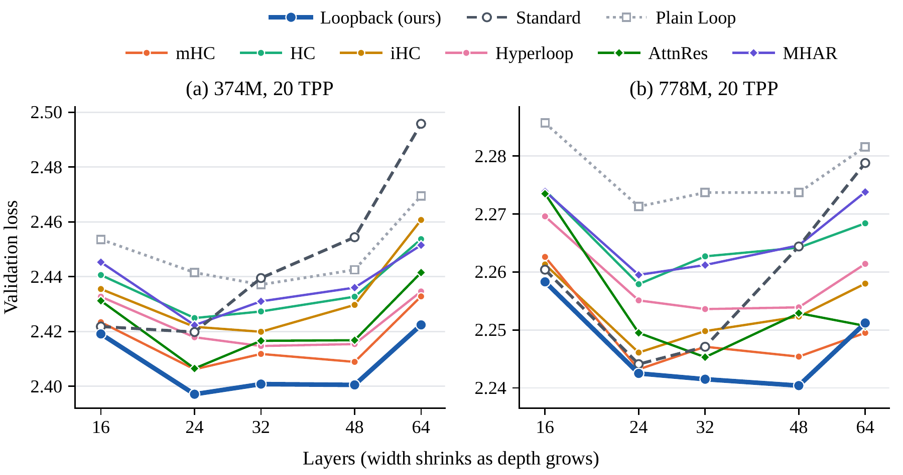
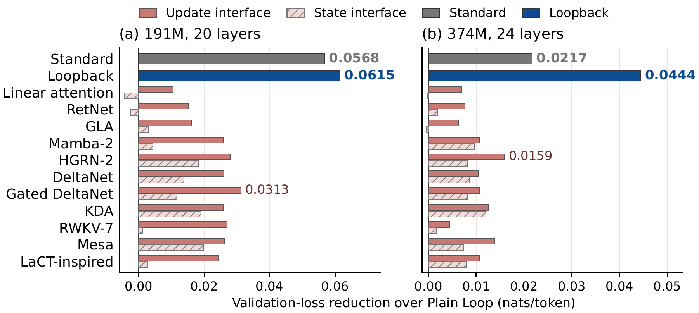

# Loopback Transformer: Towards a Unified View of Residual Looped Transformers

[**Xuan Ouyang**](https://yancyou.github.io/)<sup>1,\*</sup>, [**Zefan Cai**](https://zefan-cai.github.io/)<sup>1,\*</sup>, [**Chenlong Zhang**](https://chenlong-clock.github.io/)<sup>2</sup>, [**Cheng Luo**](https://wdlctc.github.io/)<sup>3</sup>, [**Ke Wan**](https://cseweb.ucsd.edu/~kewan/)<sup>4</sup>, [**Junjie Hu**](https://junjiehu.github.io/)<sup>1,✉</sup>

<sup>1</sup>University of Wisconsin–Madison &nbsp;&nbsp; <sup>2</sup>University of California, Santa Barbara &nbsp;&nbsp; <sup>3</sup>California Institute of Technology &nbsp;&nbsp; <sup>4</sup>Microsoft

<sup>\*</sup>Equal contribution &nbsp;&nbsp; <sup>✉</sup>Corresponding author

**[Paper (arXiv:2611.07226)](https://arxiv.org/abs/2611.07226)** &nbsp;·&nbsp; **[Project page](https://yancyou.github.io/Loopback_page/)**

Looped Transformers reduce parameter count by applying shared blocks repeatedly. We take the depth-memory view of
residual connections: each block application writes an update, and later block applications read a weighted sum of the
stored updates. Reading the individual updates, with the loop input kept on its own path, separates three controls:
the input's strength, the total weight of the updates, and how that total is allocated across them. The Loopback
Transformer implements them: geometric decay sets the total update weight and supplies a recency prior, and attention
learns the allocation. On ClimbMix, Loopback reaches lower validation loss than the standard Transformer with 40–75% of
its Transformer parameters at reference scales from 191M to 3B, at matched training tokens and executed depth, and the
highest thirteen-task mean among nine residual designs at 191M, 374M and 778M.

<p align="center"></p>

**Figure 1.** Loopback against the standard Transformer at 191M–3B after 20 tokens per parameter: validation loss,
Transformer parameters (shared blocks counted once) and the thirteen-task zero-shot mean.

<p align="center"></p>

**Figure 3.** Loopback separates input, decay and allocation. (a) Shared blocks with a learned read after every
application. (b) Iteration-end decay sets the prior and the total weight. (c) Attention redistributes that total over
the block updates, keeping the input coefficient at one.

## The model

A looped Transformer `[P → K×R → C]` applies P prelude blocks, then K shared blocks R times (R iterations), then C coda
blocks. Loopback changes only the residual rule between block applications. With $`h_0`$ the loop input (the prelude
output) and $`d_i = f(h_i) - h_i`$ the update written by the $`i`$-th application of a shared block, the state after
application $`s`$ is

```math
\begin{aligned}
h_{s+1} &= h_0 + \sum_{i \le s} c_{s,i}\, d_i \\
c_{s,i} &= B_s \cdot \mathrm{softmax}_i\left(\frac{q_s \cdot k_i}{\sqrt{d}} + \log c^0_{s,i}\right),
\qquad k_i = \frac{d_i}{\sqrt{\mathrm{mean}(d_i^2) + \epsilon}} \\
c^0_{s,i} &= \lambda^{\lfloor (s+1)/K \rfloor - \lfloor i/K \rfloor}, \qquad B_s = \sum_{i \le s} c^0_{s,i}
\end{aligned}
```

- the loop input keeps coefficient 1, and every update $`d_i`$ is stored on its own;
- one learned query $`q_s`$ per read, zero at initialization (the first read has none);
- the keys are the RMS-normalized updates and the values the updates themselves, without projections;
- the decay prior $`c^0`$ is multiplied by λ at every iteration end.

<p align="center">
  <picture>
    <source media="(prefers-color-scheme: dark)" srcset="assets/loopback_read_dark.gif">
    
  </picture>
</p>

**The two steps of every read** (K = 2, λ = 1/4; from the [project page](https://yancyou.github.io/Loopback_page/)).
Row $`s`$ holds the coefficients $`c_{s,i}`$ on the stored updates $`\delta_i`$ (the $`d_i`$ above). Step 1: a new update
enters with prior 1, and every entry is multiplied by λ at an iteration end (×λ). Step 2: attention moves weight between
the updates (the numbers, from illustrative scores) while each row's total $`B_s`$ stays the same.

Decay sets the total $`B_s`$ and attention allocates it. After $`r`$ complete iterations
$`B_s = K(\lambda + \dots + \lambda^r)`$, which stays below $`K\lambda/(1-\lambda)`$ however many iterations are added
(λ = 1/4 in the paper); without decay it would be $`Kr`$. With zero queries the model is the decay-only loop
$`h \leftarrow h_0 + \lambda\,(F(h) - h_0)`$, and with λ = 1 it is Plain Loop. The queries are the only new parameters,
$`(KR - 1)\,d`$ of them; the shared blocks are unchanged.

## What is here

| | |
|---|---|
| `looped_transformer.py` | the model in plain PyTorch (no fla / flash-attn / transformers): Standard, Plain Loop, Loopback and the eleven readers; loads the trainer's checkpoints |
| `fused_dattn.py` | Loopback's read as one Triton kernel per read (`LOOP_DATTN_FUSED=1`); the reference read is the default. With it the trainer keeps the updates of a forward pass in one stack and accumulates their gradients inside the kernels (`LOOP_DATTN_STACK=1`, the default), and each write stores the update's scores against the read queries, so that a read is one pass over the stack (`LOOP_DATTN_DOTS=1`, the default) |
| `loop_linattn_delta.py`, `loop_linattn_state.py` | the linear-attention readers on the loop axis over whole-iteration updates / stored states (linear attention, RetNet, Mamba-2, GLA, HGRN-2, DeltaNet, Gated DeltaNet, KDA, RWKV-7, LaCT-inspired, Mesa) |
| `trainer/` | the flame (torchtitan) trainer the paper's runs executed, with the same model as a HuggingFace custom model, and the WSD ladder driver |
| `configs/` | the configuration of every run the paper reports for these designs, at 191M / 374M / 778M / 1.4B / 3B and in the depth sweep (`configs/README.md`) |
| `scripts/` | data and tokenizer download; the validation-loss, downstream, math / code and extra-iteration evaluations |
| `tests/` | port equivalence (plain PyTorch vs the trainer's model, bitwise in fp32), the fused read vs the reference read, the mechanism against the paper's equations, the readers against an independent oracle |
| `results/` | the paper's numbers for these designs (`results/README.md`) |
| `assets/` | the paper's figures and the read animation |
| `licenses/` | the licence texts of the third-party code (`THIRD_PARTY.md`) |

Mode names in the configs are the ones the checkpoints were trained with: `loop_residual_mode: "delta_attnres"` is
Loopback (`skip0_beta` = β = 1 − λ = 0.75), `null` is Plain Loop (and, with `num_middle_param_layers: null`, Standard),
and a reader's name with `linattn_source` "delta" | "state" selects a reader. The paper's six other looped designs
(mHC, HC, iHC, Hyperloop, MHAR, AttnRes) are not part of this release.

## Using the model

```python
from looped_transformer import LoopedTransformerLM

# Loopback at 191M
m = LoopedTransformerLM.from_json("configs/191m_d768x20/lt124m_ours_p2k4l4c2_4klen.json")
out = m(input_ids, labels=input_ids)  # out["loss"], out["logits"]
# out["hidden_states"] as well with output_hidden_states=True
```

A trained checkpoint (torch.distributed.checkpoint shards under `<run>/checkpoint/step-N`) loads into either
implementation with `scripts/loopback_eval.load_model(dump, step, config, impl="trainer" | "port")`.

## Data and tokenizer

```bash
# ClimbMix text -> $DATA_ROOT/train/*.arrow and $DATA_ROOT/val/
python scripts/fetch_data.py --root $DATA_ROOT
# the Llama 32k tokenizer -> trainer/transformer-1.3B-100B/
bash scripts/fetch_tokenizer.sh
```

The paper trained on ClimbMix. Its public text release (100 jsonl parts) is sorted by topic cluster, so `fetch_data.py`
reads the same share of every part (`--fraction 0.067`, the default: about 26B tokens, the 191M–778M budget;
`--fraction 0.17`: about 66B, for 1.4B and 3B), deals the documents into shuffled shards with the corpus's cluster
mixture, and holds out a validation shard. The paper's own runs used a private re-sharding of the whole corpus (every
shard a uniform sample of all clusters), so a rerun sees the same distribution with other documents and matches the
paper to within run-to-run variation (the seed table in `results/README.md`).

## Training

Environment: Python ≥ 3.10, PyTorch ≥ 2.4 with CUDA, and flame's dependencies (`flash-linear-attention`, `flash-attn`,
`torchtitan`, `transformers`, `datasets`); `trainer/README.md` lists the versions the paper's runs used. Triton is needed
only for the fused read.

One table = one call of the WSD ladder driver, which trains every arm to the requested tokens-per-parameter budget
(linear warmup 128 steps, peak held, the last 10% decayed to 0 along 1 − √u; AdamW (0.9, 0.95), ε 1e-15, weight decay 0,
clip 1, seed 42) and evaluates each finished rung. The 191M table (8 GPUs, 524,288 tokens per step, 20 TPP = 7,280 steps):

```bash
cd trainer
SELF_TAG=t191 NREF=190741248 MICRO=16 ACCUM=1 NGPU=8 TPPS=20 ORDER=arm LOOP_DATTN_FUSED=1 \
DATA_ROOT=$DATA_ROOT OUT_DIR=$OUT_DIR \
ARMS="standard:../configs/191m_d768x20/lt124m_dense20_4klen.json:1e-3 \
      plain_loop:../configs/191m_d768x20/lt124m_plain_p2k4l4c2_4klen.json:3e-3 \
      loopback:../configs/191m_d768x20/lt124m_ours_p2k4l4c2_4klen.json:3e-3" \
bash queue_wsd_ladder.sh
```

`NREF` is Standard's total parameter count, on which the budget is counted (191M 190,741,248; 374M 373,867,520; 778M
777,856,512; 1.4B 1,415,682,048; 3B 2,914,667,520); `MICRO × ACCUM × NGPU × 4096` is the tokens per step (374M 8 × 4;
778M 8 × 8; 1.4B 8 × 15; 3B 4 × 60). The paper's step counts need `TPP_UNIT=5 TPPS="5 20"` at 374M and 778M (a 5-TPP rung
whose pre-decay checkpoint the 20-TPP rung continues; one uninterrupted trajectory) and `TPP_UNIT=1 TPPS="1 20"` at 3B;
`trainer/README.md` has the full per-scale table and the learning rates (`results/README.md` too). Each arm's result line
(`RESULT <arm> rung 20 ... climb=<loss>`) and a markdown table land in `$OUT_DIR`. A single arm without the ladder:
`GPUS=0,...,7 MODEL_CONFIG=<json> DATA=<glob> TOK=<tokenizer dir> STEPS=<n> bash scripts/run_local_train.sh`.

Loopback's fused read (`LOOP_DATTN_FUSED=1`, Triton) reproduces the reference read to fp32 round-off and is what the paper's
throughput numbers use; without it the reference read runs (the checkpoints are the same either way). The released kernels
are faster than the ones the paper's throughput table was measured with: they keep the updates of a forward pass in one
stack, accumulate their gradients inside the kernels, and store each update's scores against the read queries when it is
written, so that a read is one pass over the stack (outputs equal to fp32 round-off). With them, Loopback's training
throughput on 8 H100s is 0.91x / 0.90x / 0.94x / 0.96x / 0.98x Standard's at 191M / 374M / 778M / 1.4B / 3B, with peak
memory at most 4.5% above Standard's (374M: 29.1 vs 27.8 GiB per GPU). `results/README.md` keeps the paper's
measurements.

## Evaluation

The evaluations of the paper, on a run directory (`--dump`), its step and its config; `--impl trainer` (default) is the
training model the paper's numbers were computed with, `--impl port` the plain-PyTorch model (CPU or GPU).

```bash
T=trainer/transformer-1.3B-100B; V="$DATA_ROOT/val/*.arrow"

# validation loss
python scripts/eval_climb_val.py --dump $RUN --step 7280 --config $CFG --tokenizer $T \
    --data_glob "$V" --out val.json
# the 13 tasks + WikiText (lm-eval, BOS prompts, 1,000 bootstrap draws); the 13-task mean
python scripts/eval_downstream.py --dump $RUN --step 7280 --config $CFG --tokenizer $T \
    --out ds/ --arm loopback
python scripts/aggregate_downstream.py ds/*.json
# reference-solution loss on GSM8K, MATH-500, HumanEval and MBPP; five-shot word problems
python scripts/fetch_eval_data.py --data eval_data
python scripts/eval_math_code.py --dump $RUN --step 7280 --config $CFG --tokenizer $T \
    --data eval_data --out math.json
# more iterations at inference
python scripts/eval_extra_visits.py --dump $RUN --step 7280 --config $CFG --tokenizer $T \
    --data_glob "$V" --iterations 1,2,3,4,5,6,8 --out visits.json
```

## Tests

```bash
# plain PyTorch vs the trainer's model, bitwise in fp32 on the paper's configs (GPU: + bf16)
python tests/test_looped_transformer_port.py
# the fused read vs the reference read, kernel-level and whole-model (GPU)
python tests/test_fused_dattn.py
# the stacked layout of the fused read vs its list layout (bitwise; with stored scores, fp32 round-off), and that
# a kept loss does not keep its pass's stack (GPU)
python tests/test_dattn_stack.py
# the read against the paper's equations: prior schedule, coefficients, Plain Loop at λ = 1
python tests/test_loopback.py
# the readers over stored states: factored == materialized state, init = Plain Loop, ...
python tests/test_linattn_state.py
# the same for the readers over whole-iteration updates (oracle: tests/reference_linattn.py)
python tests/test_linattn_delta.py
# the paper's materialized-state form (fp64) vs the factorized read (also --interface delta)
python tests/test_linattn_audit.py --interface state
# the reader files and the fused read are byte-identical in trainer/
bash tests/test_vendored_copies.sh
```

## Results

<p align="center"></p>

**Training loss of the standard Transformer and Loopback.** 100-step moving averages against tokens seen; insets show the
last quarter of training; Δ is the final training-loss difference, Loopback minus the standard Transformer, over the last
100 steps. Loopback stores 40–75% of the standard baseline's Transformer parameters.

<p align="center"></p>

**General benchmarks at 1.4B and 3B.** Loopback uses 68% and 75% of Standard's Transformer parameters while attaining
lower validation loss and higher thirteen-task mean accuracy.

<p align="center"></p>

**Depth at fixed parameters.** ClimbMix validation loss after 20 TPP as each scale trades width for depth at approximately
fixed total parameters and fixed training tokens; looped rules make two iterations through a shared stack.

<p align="center"></p>

**Depth-memory readers.** Validation-loss reduction over Plain Loop at 191M and 374M (24 layers) for the update interface
(solid) and the state interface (hatched) of each reader; Standard and Loopback are references.

The numbers behind these figures, the readers' table, the seeds, the extra-iteration and math / code evaluations and
the memory accounting are in `results/README.md`.

## Citation

```bibtex
@article{ouyang2026loopback,
  title         = {Loopback Transformer: Towards a Unified View of Residual Looped Transformers},
  author        = {Ouyang, Xuan and Cai, Zefan and Zhang, Chenlong and Luo, Cheng and Wan, Ke and Hu, Junjie},
  journal       = {arXiv preprint arXiv:2611.07226},
  year          = {2026},
  eprint        = {2611.07226},
  archivePrefix = {arXiv},
  primaryClass  = {cs.LG},
  url           = {https://arxiv.org/abs/2611.07226}
}
```

## License

MIT (`LICENSE`) for this project's code. The trainer is derived from fla-org/flame (MIT) and contains files from
pytorch/torchtitan (BSD-3-Clause) and fla-org/flash-linear-attention (MIT); `THIRD_PARTY.md` lists them and
`licenses/` holds their licence texts.
